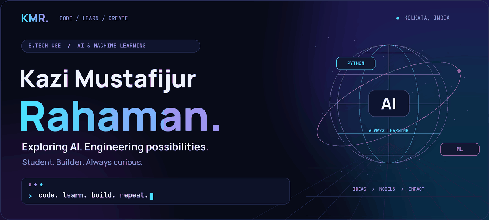
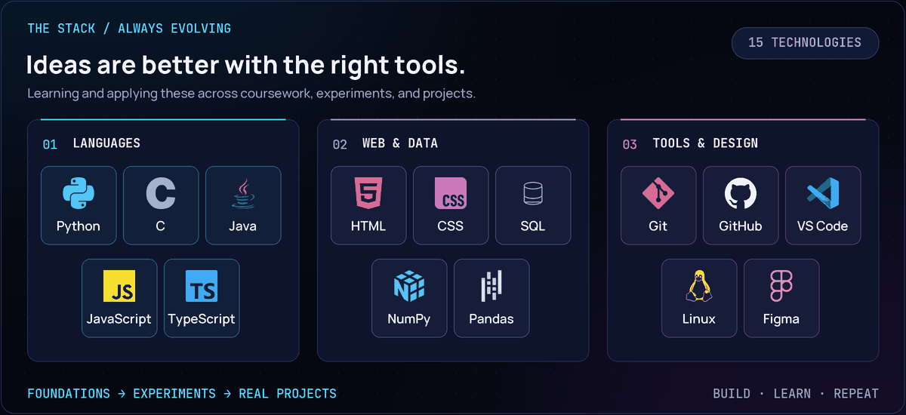
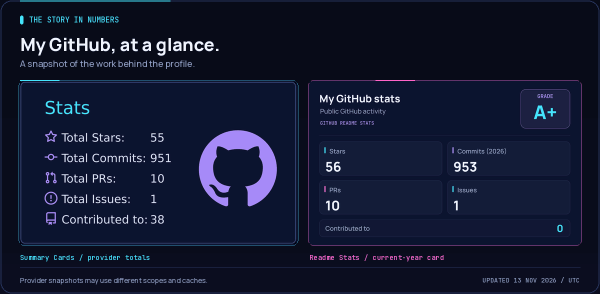
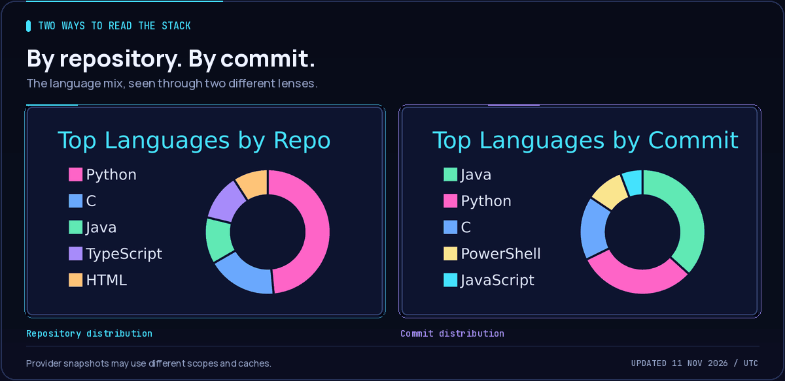
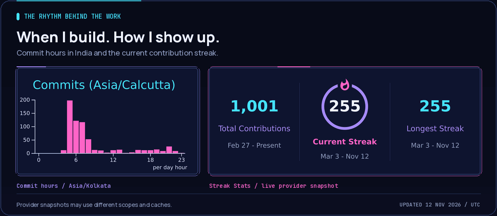
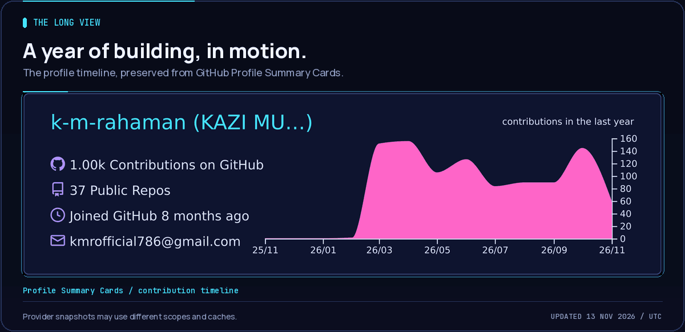
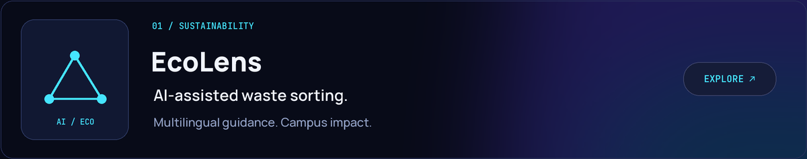
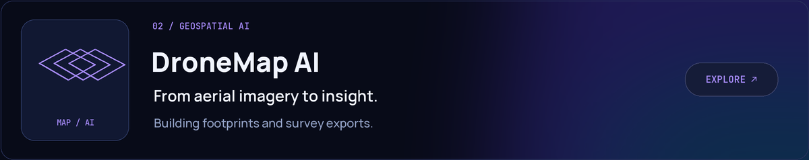
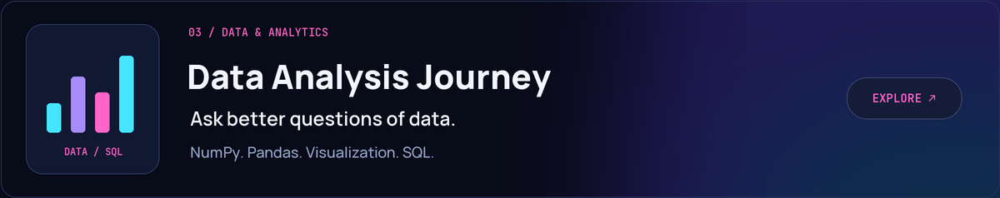

<!-- Actual looping GIFs are stored in assets/. Commit this README together with assets/, scripts/, and .github/. -->

  <picture>
    <source media="(max-width: 600px)" srcset="./assets/hero-mobile.gif" />
    
  </picture>

  
  
  

  <a href="#about-me">About</a> &nbsp; / &nbsp;
  <a href="#tech-stack">Stack</a> &nbsp; / &nbsp;
  <a href="#github-stats-and-grade">Stats</a> &nbsp; / &nbsp;
  <a href="#commit-hours-and-streaks">Activity</a> &nbsp; / &nbsp;
  <a href="#featured-work">Projects</a> &nbsp; / &nbsp;
  <a href="#lets-connect">Connect</a>

## About me

I'm **Kazi Mustafijur Rahaman**, a **B.Tech Computer Science Engineering student specializing in AI/ML**, based in **Kolkata, India**.

I learn by building: from programming and data structures to web applications, data analysis, and AI experiments. I'm interested in the point where a useful idea becomes something people can actually use.

- **Learning:** stronger programming fundamentals, problem solving, and machine learning concepts.
- **Building:** practical projects that connect code, data, and real-world problems.
- **Working toward:** becoming an AI/ML engineer with strong engineering foundations.

## Tech stack

  <picture>
    <source media="(max-width: 600px)" srcset="./assets/tech-stack-mobile.gif" />
    
  </picture>

  
<b>Tap to explore the toolkit</b>

| Area | Technologies I'm learning and using |
| :--- | :--- |
| Programming | Python · C · Java · JavaScript · TypeScript |
| Web | HTML · CSS · JavaScript · TypeScript |
| Data and analysis | SQL · NumPy · Pandas · Data visualization |
| Development | Git · GitHub · VS Code · Linux |
| Design | Figma |

These reflect coursework, practice, and project work; I'm continuing to develop depth across them.

## GitHub stats and grade

  <a href="./assets/stats-summary.md" title="Open current values, source cards, and refresh details">
    <picture>
      <source media="(max-width: 600px)" srcset="./assets/classic-stats-overview-mobile.gif" />
      
    </picture>
  </a>

## Languages by repo and by commit

  <a href="./assets/stats-summary.md" title="Open current values, source cards, and refresh details">
    <picture>
      <source media="(max-width: 600px)" srcset="./assets/classic-stats-languages-mobile.gif" />
      
    </picture>
  </a>

## Commit hours and streaks

  <a href="./assets/stats-summary.md" title="Open current values, source cards, and refresh details">
    <picture>
      <source media="(max-width: 600px)" srcset="./assets/classic-stats-activity-mobile.gif" />
      
    </picture>
  </a>

## Contribution timeline

  <a href="./assets/stats-summary.md" title="Open current values, source cards, and refresh details">
    <picture>
      <source media="(max-width: 600px)" srcset="./assets/classic-stats-profile-mobile.gif" />
      
    </picture>
  </a>

  
<b>Tap to explore the stats and their sources</b>

- **By repo:** the original repository-language distribution card.
- **By commit:** the original commit-language distribution card, kept separate from code-byte statistics.
- **Grade card:** the provider-calculated rank, refreshed with its actual statistics.
- **Activity:** commit hours use **Asia/Kolkata (UTC+05:30)**; the streak card uses its own provider calculation.
- **Counts:** different services have their own scopes and caches, so totals can differ between cards.

[View exact current values and source links →](./assets/stats-summary.md)

## Featured work

<a href="https://github.com/k-m-rahaman/Ecolens">
  <picture>
    <source media="(max-width: 600px)" srcset="./assets/project-ecolens-mobile.png" />
    
  </picture>
</a>

  

<a href="https://github.com/k-m-rahaman/DroneMap_AI_2.0">
  <picture>
    <source media="(max-width: 600px)" srcset="./assets/project-dronemap-mobile.png" />
    
  </picture>
</a>

  

<a href="https://github.com/k-m-rahaman/Python-Data-Analysis-Journey">
  <picture>
    <source media="(max-width: 600px)" srcset="./assets/project-data-mobile.png" />
    
  </picture>
</a>

<a href="https://github.com/k-m-rahaman?tab=repositories"><b>Explore all repositories ↗</b></a>

## Let's connect

I'm happy to connect with fellow learners, exchange ideas, and explore thoughtful technology projects.

  
  
  

  <picture>
    
  </picture>

<a href="https://visitor-badge.laobi.icu/badge?page_id=k-m-rahaman.k-m-rahaman">View the live profile visitor counter ↗</a>

  
<b>Prefer static graphics? Open the PNG versions</b>

[Banner](./assets/hero.png) · [Technology stack](./assets/tech-stack.png) · [Stats and grade](./assets/classic-stats-overview.png) · [Languages by repo and commit](./assets/classic-stats-languages.png) · [Commit hours and streak](./assets/classic-stats-activity.png) · [Contribution timeline](./assets/classic-stats-profile.png)

